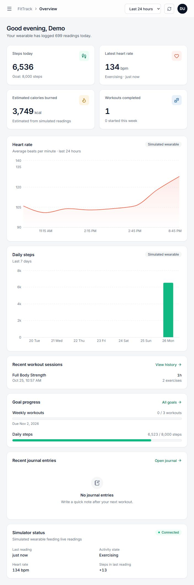

# Fitness & Habit Tracking Platform with Wearable-Style Time-Series Simulation

DBMS mini-project. A fitness and habit tracker built on a **hybrid DBMS**:
**MySQL** holds structured, related data (users, roles, profiles, plans, exercises, sessions, sets, goals, habits, schedules, coaches, subscriptions),
and **Redis** (Memurai on Windows, or Redis in WSL) holds the high-volume and flexible data
(simulated wearable time series, daily totals, journal entries, progress-photo metadata).

| Team member | SRN |
|---|---|
| Manasi Vipin | PES1UG24CS260 |
| Malavika Arun Menon | PES1UG24CS257 |

| Part | Technology | Folder |
|---|---|---|
| Web interface | **Next.js 16** (App Router), React 19, Tailwind CSS v4, Recharts | `frontend/` |
| Backend / API | Node.js + Express (REST, JWT, bcrypt), talks to both databases | `backend/` |
| Databases | MySQL 8 (relational) + Redis / Memurai (NoSQL: streams, hashes, JSON strings) | `database/` |
| Wearable simulator | Node.js script writing a reading per user to Redis every 5 s | `simulator/` |



## Features

- Accounts with sign-up, sign-in, profile, and two roles (**member**, **admin**).
- Workout plans with exercises, sets, reps and target weights. Workouts can be started, logged set by set and finished.
- Fitness goals with automatic completion (database trigger).
- Daily habits with check-ins and seven-day completion. Plans can be put on a workout schedule. Members can enrol with a (fictional) coach.
- Simulated wearable data (heart rate, steps, calories) with live dashboard and analytics charts.
- **Heart-rate anomaly alerts**: readings above 85% of the age-estimated maximum, above 100 bpm at rest, or below 40 bpm.
- **Weekly report** combining both databases, downloadable as CSV.
- Free-text workout journal with search, and progress-photo entries.
- Admin page for users and roles: role changes go through a stored procedure with an audit log.

## Functional requirements

| ID | Requirement | Where |
|---|---|---|
| FR1 | A visitor can create an account; passwords are stored only as bcrypt hashes | `/signup`, `users` |
| FR2 | A user can sign in and receives a JWT; protected pages and APIs reject requests without it | `/login`, `middleware/auth.js` |
| FR3 | A user can view and edit a profile (date of birth, gender, height, weight, fitness level) | `/profile`, `user_profiles` |
| FR4 | A member can create, edit and delete workout plans made of exercises with sets, reps and targets | `/plans`, `workout_plans`, `plan_exercises`, `exercises` |
| FR5 | A member can start a workout, log sets and finish it; sets cannot be added to a finished workout | `/history`, `workout_sessions`, `workout_sets`, trigger `trg_sets_locked_session` |
| FR6 | A member can set fitness goals; a weekly-workout goal is marked completed automatically when reached | `/goals`, `fitness_goals`, trigger `trg_session_finished` |
| FR7 | A member can add daily habits, check them in per day and see a seven-day completion count | `/routine`, `habits`, `habit_checkins` |
| FR8 | A member can schedule a workout plan on a date (one schedule per plan per date) | `/routine`, `workout_schedule` |
| FR9 | A member can subscribe to and unsubscribe from a coach | `/routine`, `coaches`, `subscriptions` |
| FR10 | The simulator generates heart rate, steps and calories for every registered user every 5 s | `simulator/`, Redis stream and daily hash |
| FR11 | The dashboard and analytics pages show live values and trends for 1 h, 24 h, 7 d and 30 d | `/`, `/analytics` |
| FR12 | The system flags heart-rate readings outside age-based limits | `/reports`, `GET /api/reports/heart-rate-alerts` |
| FR13 | A member can view a seven-day report and download it as CSV | `/reports`, `GET /api/reports/weekly` |
| FR14 | A member can create, search, edit and delete journal entries | `/journal`, Redis `fittrack:journal:*` |
| FR15 | A member can add, edit and delete progress-photo entries (caption, date, tags, optional image URL) | `/gallery`, Redis `fittrack:photos:*` |
| FR16 | An admin can list users and change roles; every change is audited and the last admin cannot be demoted | `/admin`, `sp_change_role`, `role_audit_log` |
| FR17 | A member is refused admin pages and APIs; each member sees only their own records | `requireRole`, ownership checks in every query |

## Setup (once)
1. Copy `.env.example` to `.env` and fill in the values (MySQL root password, the two database account passwords, Redis settings, `JWT_SECRET`). `.env` is git-ignored. Do not put `#` inside a value, because dotenv treats it as the start of a comment.
2. Make sure **MySQL** and **Redis/Memurai** are running (`redis-cli ping` should return `PONG`).
3. Install packages:
   ```
   npm install            (project root - needed by the database scripts)
   cd backend  && npm install
   cd frontend && npm install
   cd simulator && npm install
   ```
4. Build the database (creates the 15 tables, triggers, procedure, function, views, seed data, database roles and accounts):
   ```
   node database\setup_mysql.js
   ```
   An older `fittrack_db` can be upgraded in place with `node database\migrate.js` (keeps existing records).

## Run (three separate terminals, all from the project root)
| Terminal | Command | Notes |
|---|---|---|
| 1 | `cd backend` then `npm start` | API on http://localhost:5000 (`/api/health` checks both databases) |
| 2 | `cd frontend` then `npm run dev` | Next.js app on http://localhost:3000 |
| 3 | `node simulator\wearableSimulator.js` | Generates readings for **every registered user** |

Open http://localhost:3000, then sign in with a demo account (see [`DEMO_GUIDE.md`](DEMO_GUIDE.md#demo-accounts-passwords-are-stored-only-as-bcrypt-hashes)), **Create an account**, or **Continue as demo user**.
Admins see an extra **Users & roles** page. On Windows, `powershell -ExecutionPolicy Bypass -File scripts/start-demo.ps1` starts the backend and the production frontend after `npm run build`.

## Tests
```
npm test                    unit tests (dates, IDs, heart-rate rules)
npm run test:integration    isolated MySQL + API checks in a temporary fittrack_test_* database
npm run test:smoke          live API checks (backend, MySQL and Redis must be running)
npm run build               Next.js production build
```
Results are recorded in [`TEST_RESULTS.md`](TEST_RESULTS.md).

## Roles
| Level | Role | What it can do |
|---|---|---|
| Application (`users.role`) | `member` | own plans, sessions, goals, habits, schedule, subscriptions, journal, gallery and reports |
| Application (`users.role`) | `admin` | everything a member can do, plus **Users & roles** (change roles, see the activity and audit logs) |
| Database (MySQL roles) | `fittrack_member` (account `ft_member`) | reads permitted app data (not password hashes or role audit), writes permitted tables; the API enforces ownership |
| Database (MySQL roles) | `fittrack_admin` (account `ft_admin`) | full control of `fittrack_db` |

## Where user data lives
| Data | Store | Table / key |
|---|---|---|
| Account (name, email, bcrypt password hash, role, created, last sign-in) | MySQL | `users` |
| Personal details | MySQL | `user_profiles` (1:1 with `users`) |
| Plans, exercises in a plan, sessions, sets, goals | MySQL | `workout_plans`, `plan_exercises`, `exercises`, `workout_sessions`, `workout_sets`, `fitness_goals` |
| Habits, check-ins, scheduled workouts | MySQL | `habits`, `habit_checkins`, `workout_schedule` |
| Coaches and coaching subscriptions | MySQL | `coaches`, `subscriptions` |
| Automatic logs (written by triggers / procedure) | MySQL | `activity_log`, `role_audit_log` |
| Wearable readings, daily totals | Redis | stream `fittrack:sensors:{userId}`, hash `fittrack:activity:daily:{userId}:{date}` |
| Journals, photo entries | Redis | `fittrack:journal:{userId}:{id}`, `fittrack:photos:{userId}:{id}` |
| Weekly report, heart-rate alerts | both | computed on request from the tables and keys above (alerts use the date of birth in `user_profiles`) |

Passwords are never stored in plain text: only bcrypt hashes. Database credentials come from `.env`, never from the source code.

## Why two databases
- **MySQL** is used where the data is related and must stay consistent. Plans own exercises, sessions own sets, and habits own check-ins. Foreign keys, CHECK/UNIQUE constraints, transactions, joins, triggers and a stored procedure apply here.
- **Redis** is used where data arrives often or has no fixed shape. Every user gets a reading every 5 s, appended to a stream and read back by time range. Daily totals are counters in a hash. Journal and photo entries are JSON documents whose fields can vary.
- The API joins the two by user ID and date. There is no cross-database transaction or foreign key; deleting a MySQL user does not remove that user's Redis keys.

## Documentation
| Document | Contents |
|---|---|
| [`DEMO_GUIDE.md`](DEMO_GUIDE.md) | Commands and expected results for each DBMS requirement, demo accounts |
| [`REVIEW_READINESS.md`](REVIEW_READINESS.md) | Requirements checklist, architecture, scope, review sequence, contribution table |
| [`TEST_RESULTS.md`](TEST_RESULTS.md) | Automated and manual test results, screenshots |
| [`docs/BACKEND_GUIDE.md`](docs/BACKEND_GUIDE.md) | Backend architecture, request lifecycle, middleware, routes, controllers, Redis and MySQL access, and likely questions |
| [`database/docs/`](database/docs) | ER diagram (`ER_DIAGRAM.md`, `er_diagram.png`), relational schema, data dictionary, screen-to-table mapping |
| [`database/queries.sql`](database/queries.sql) | 19 labelled queries: joins, aggregates, nested and correlated subqueries, CTEs, window function, views, EXPLAIN |
| [`database/demo/`](database/demo) | Scripts for roles, schema inspection, CRUD on all 15 tables, trigger, procedure/function, access control, Redis |

## Useful commands
```
node database\show_users.js                  list users, roles and profiles
node database\migrate.js                     upgrade an existing database
node database\memurai_setup.js               test Redis/Memurai and write sample data
```

## Limitations
- Wearable values are simulated, and the anomaly rules are fixed thresholds, not medical advice.
- Journal search filters the loaded entries in the browser; it is not a full-text or vector index.
- Coaches are a fictional catalogue: there is no coach login, no messaging and no payment.
- Redis data survives restarts only if Redis persistence (RDB/AOF) is enabled.
- The API connects to MySQL as `DB_USER` (`root` in the default `.env`) and to Redis without credentials. The `ft_member`/`ft_admin` accounts and the `ft_redis_member` ACL user are defined but not yet used by the API. See [`docs/BACKEND_GUIDE.md`](docs/BACKEND_GUIDE.md#12-known-limitations).
