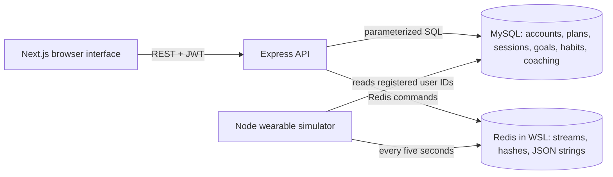

# Synopsis comparison and review readiness

Reviewed on 26 October 2026 and updated on 5 November 2026 against **DBMS Project Synopsis.pdf** (2 pages), **DBMS Level 3 Project Requirements draft.pdf** (18 requirements) and the **Level 3 Mini-Project Evaluation Criteria** (50-mark rubric, mapped below).

## What the comparison found

At that point the project already had the Next.js App Router interface, authentication, two application roles, MySQL and Redis integration, plans/exercises/sessions, goals, dashboard, searchable journal, photo metadata, SQL examples, ER assets and database programmability.

The synopsis explicitly mentions habit tracking, workout schedules, Coaches and Subscriptions, but these were not connected to a usable application workflow. The new **Habits & schedule** page closes these gaps with daily check-ins and seven-day completion counts, dated plans, a fictional coach catalogue and subscribe/unsubscribe actions. Coaching is enrolment only: no billing, messaging or coach login is claimed.

The review also found a cross-user session-plan reference, a hard-coded JWT fallback, no executable test suite, and misleading descriptions of database row ownership. Those have been addressed. Existing user changes and data were retained.

## 50-mark rubric and evidence

| # | Rubric component (marks) | Evidence in this repository |
|---|---|---|
| 1 | ER diagram (2) | `database/docs/er_diagram.png` / `.svg`, `ER_DIAGRAM.md`: all 15 tables with keys and cardinalities |
| 2 | Relational schema with keys, relationships, constraints (3) | `database/docs/RELATIONAL_SCHEMA.md` (ER-to-table mapping, data dictionary) |
| 3 | SQL DDL with constraints (4) | `database/schema.sql`, `extensions.sql`: PK, FK with ON DELETE rules, UNIQUE, CHECK, indexes; `demo/02_schema_inspection.sql` |
| 4 | NoSQL database creation (4) | Redis key design in `database/README.md`; stream, hash and JSON-string keys written by `simulator/` and the API; `memurai_setup.js` |
| 5 | Technology justification (1) | README section *Why two databases*; architecture section below |
| 6 | DML operations (4) | `demo/03_crud_all_tables.sql`: INSERT/UPDATE/DELETE on all 15 tables; every screen's writes in the controllers |
| 7 | Nested / correlated / recursive and join queries (4) | `database/queries.sql` (19 queries: joins, NOT IN / NOT EXISTS, correlated subqueries, `WITH RECURSIVE` habit streak), `demo/07_nested_query.sql` |
| 8 | Procedure/function, trigger, CTE (6) | `sp_change_role`, `fn_session_volume`, triggers `trg_sets_locked_session` and `trg_session_finished` in `programmability.sql`; CTEs in queries 10, 11 and 15; `demo/04`, `demo/05` |
| 9 | NoSQL feature: read, update, delete (7) | Journal and photo create/read/update/delete, stream range reads for charts and heart-rate alerts, daily hash counters; `demo/08_redis_crud.txt` |
| 10 | Next.js interface (3) | `frontend/src/app` (App Router): 13 screens including `/routine` and `/reports` |
| 11 | Backend/API and database integration (2) | Express API using both stores; `/api/health`; weekly report merges MySQL and Redis by day |
| 12 | Authentication, two roles, access control in the database (4) | bcrypt + JWT, `requireRole('admin')`, MySQL roles `fittrack_admin` / `fittrack_member` (`security/roles.sql`), `demo/06_rbac_member_denied.sql`, Redis ACL `demo/09_redis_acl.sh` |
| 13 | Documentation, Git/GitHub (2) | README, this file, `DEMO_GUIDE.md`, `TEST_RESULTS.md`, `database/docs/`; commits by both members |
| 14 | Originality, individual contribution, modification/viva (4) | Contribution table below (team to complete); each member explains their part; schema can be changed and rebuilt with one command |

## Requirements and evidence

| Guideline | Current evidence / action | Remaining review responsibility |
|---|---|---|
| 1. Unique title, meaningful problem | Fitness & Habit Tracking Platform with Wearable-Style Time-Series Simulation; combines structured training with generated telemetry | Confirm title uniqueness within the section |
| 2. Two members, both contribute to DB and app | Synopsis names Nishkal M R (PES1UG24AM181) and M Naga Sai Abhiram (PES1UG24AM151) | Record actual responsibilities and authentic commits for both members; do not invent attribution |
| 3. Two database paradigms | MySQL 8 + Redis-compatible key/value, hash and stream model | Explain why Redis is a NoSQL database even though the examples list MongoDB/Neo4j |
| 4. ER, schema, data model | `database/docs/er_diagram.mmd`, `RELATIONAL_SCHEMA.md`, `extensions.sql` | Walk through keys, cardinalities and deletion rules |
| 5. DDL | `schema.sql`, `extensions.sql`, ALTER in migration, DROP/CREATE stored programs | Show actual installed constraints, not only source files |
| 6. DML and queries | Controllers, `database/queries.sql`, demo SQL scripts | Rehearse joins, aggregation, HAVING and nested queries |
| 7. Four advanced concepts | Transactions, views, procedure/function, triggers, indexes (five categories) | Demonstrate before/after data and explain business rules |
| 8. Vector search | Optional; not implemented | Explain that journal search is lexical, not semantic |
| 9. Next.js interface | `frontend/src/app`, including `/routine` and `/reports`; production build checked | Show navigation, forms, search and error handling |
| 10. API integration | Next.js -> Express -> MySQL / Redis; environment configuration | Keep database credentials server-side |
| 11. Authentication, two roles | bcrypt, signed JWT, member/admin API checks, SQL grants | Demo a member being refused an admin action |
| 12. Integrity | PK/FK/UNIQUE/CHECK; transaction and negative tests | Current local database has all inspected core CHECKs; inspect any other installation before review |
| 13. Security | Parameterized SQL, bcrypt, no JWT fallback, plan ownership fix, ignored `.env` | Demo credentials are public fixtures, never production credentials |
| 14. Documentation | README, this report, schema/dictionary, architecture below, demo guide, test report | Include genuine screenshots and explain limitations |
| 15. Git/GitHub | Team repository with commits from both members; README with setup and run instructions | Each member explains the commits for their own work |
| 16. Demonstration | `DEMO_GUIDE.md`, automated tests and rehearsal below | Each member explains both DB and application work |
| 17. Originality | Domain-specific completion trigger, hybrid dashboard and simulator | Team must explain provenance and implementation; originality cannot be certified by code inspection |
| 18. Beyond CRUD | Goal completion, generated telemetry, trends, aggregated habit completion, heart-rate anomaly alerts, cross-store weekly report with CSV export, role audit | Connect each feature to its database design |

## Problem, objectives and scope

Fitness records are split between workout plans, goals and wearable summaries. This project brings them into one dashboard without requiring a physical wearable. Objectives are to model relational training data correctly, store frequent and flexible observations appropriately, protect user-owned data, and expose meaningful database behaviour through Next.js.

In scope: account/profile management, workout planning and history, goal tracking, daily habits, scheduling, coaching enrolment, simulated heart rate/steps/calories, journals and photo metadata. Out of scope: real device connectivity, medical interpretation, paid subscriptions, messaging, binary photo storage and semantic search. The optional synopsis features are implemented: rule-based heart-rate anomaly alerts (limits from the profile's date of birth, readings from the Redis stream) and a seven-day report merging both stores, downloadable as CSV. The alert rules are fixed thresholds on simulated data, not a medical model.

## Architecture and database choice

MySQL provides referential integrity, transactional updates and joins for related records. Redis streams append generated readings; hashes update daily totals; JSON strings accommodate flexible journals and photo metadata. The API combines the two stores; there is no cross-database transaction or foreign key. Deleting a MySQL user does not automatically remove Redis keys. All wearable values are simulated, not clinical measurements.

Journal search currently filters loaded entries on the client. Retrieval uses SCAN for the current user's key prefix followed by MGET; it is not a full-text index. Stream retrieval uses time-ordered IDs and bounded range queries. A dedicated search index/pagination would be appropriate at larger scale. Redis durability depends on server persistence configuration; enable AOF/RDB for records that must survive restarts.

## Functional acceptance sequence (about 12 minutes)

1. Explain motivation, two stores, ER mapping and why a simulator is used (2 minutes).
2. Sign in as a member. Create a plan containing exercises and set/rep targets; schedule it on **Habits & schedule** (1 minute).
3. Add a habit, check it once, toggle it off/on, and show its seven-day count. Subscribe/unsubscribe to a fictional coach (1 minute).
4. Start and finish a workout; show goal completion and activity log. Explain the trigger and SQL function (2 minutes).
5. Start the simulator and show changing sensor values, trends and daily totals. Open **Weekly report**: show the alerts, the merged seven-day table and the CSV download. Create/search/edit/delete a journal and show photo metadata (2 minutes).
6. Sign in as admin, demonstrate the user directory and role audit; show a member-denied operation (1 minute).
7. Run a join/aggregate query, the nested query and EXPLAIN; point to rollback/constraint test results (2 minutes).
8. Explain each member's real contributions, limitations and future work (1 minute).

## Safe preparation and Git handoff

- Use `node database/migrate.js` to upgrade existing data. Do not drop the project database merely to rehearse. Old `00_reset_for_rehearsal.sql` modifies seeded rows and is appropriate only for a disposable demo copy.
- Fresh installations: run `node database/setup_mysql.js`; existing schemas may require restoring missing constraints after cleaning any invalid legacy rows. Inspect with `database/demo/02_schema_inspection.sql`.
- Start Redis in WSL, then backend, Next.js and simulator. Check `/api/health` reports both databases connected.
- Run `npm test`, `npm run test:integration`, and `npm run build`. Integration tests create and remove a separate random `fittrack_test_*` database; the configured MySQL account needs CREATE/DROP permission for that test only.
- Review `git diff --check`, `git status --short` and the actual diff. `.env`, dependency directories and build output must remain ignored. The working tree already contained a broad frontend migration before this review.
- Commit with the actual author's identity. The second teammate should commit their own real work. Do not rewrite history to imply contributions.
- Push only the reviewed branch. Confirm the remote and branch before doing so. This comparison does not by itself establish instructor approval, individual contributions or originality.

## Team contribution record

| Member | Database work | Application work | Demo section |
|---|---|---|---|
| Nishkal M R — PES1UG24AM181 | Project setup; MySQL schema with keys and constraints (15 tables), setup and migration scripts; triggers `trg_sets_locked_session` and `trg_session_finished`, procedure `sp_change_role`, function `fn_session_volume`, views | Next.js interface: app shell, sign-in/sign-up, shared components and every screen (overview, plans, history, goals, analytics, journal, gallery, profile, admin, habits & schedule, weekly report); unit, integration and smoke tests; ER diagram, relational schema, UI mapping, demo scripts and documentation | Steps 1-4: motivation and ER mapping, plans and schedule, habits and coaching, workout trigger and function |
| M Naga Sai Abhiram — PES1UG24AM151 | MySQL roles and accounts (`fittrack_admin`, `fittrack_member`) and Redis ACL; seed data; the 19 SQL queries; Redis key design (stream, hashes, JSON strings) and the wearable simulator | Express API: configuration, JWT authentication and role checks, admin endpoints; workouts, goals, dashboard and activity endpoints; journal and photo endpoints in Redis; habits, schedule, coaching, heart-rate alerts and weekly report endpoints | Steps 5-7: simulator, analytics, weekly report and alerts, journal and photos; admin roles and member denial; queries, nested query and EXPLAIN |

Step 8 (contributions, limitations and future work) is presented by both members. Each part above is one commit in the repository, authored by the member listed.

## Conclusion

The project demonstrates a hybrid database application beyond CRUD through telemetry, aggregation, transaction handling and goal automation. The implemented additions bring the application closer to the submitted synopsis. Both local databases and the live demo were verified; see TEST_RESULTS.md. Final review preparation still requires authentic contribution evidence and rehearsing the actual installed database rather than relying on expected outputs from a fresh seed.
