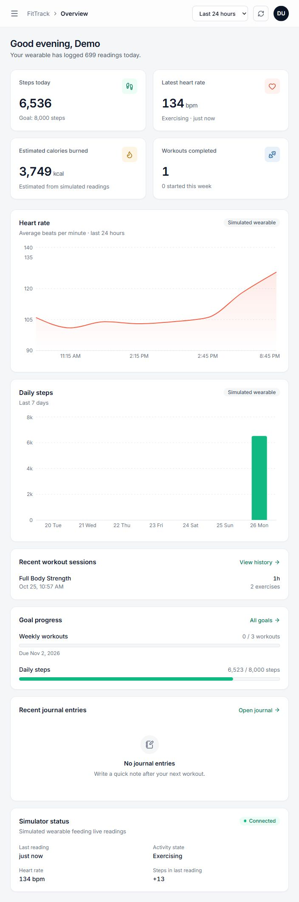
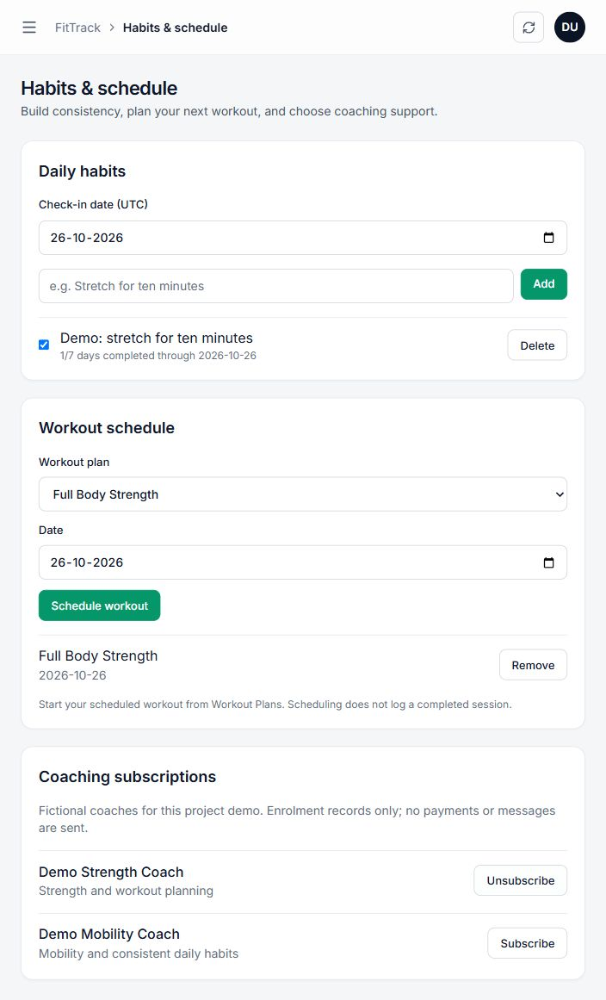
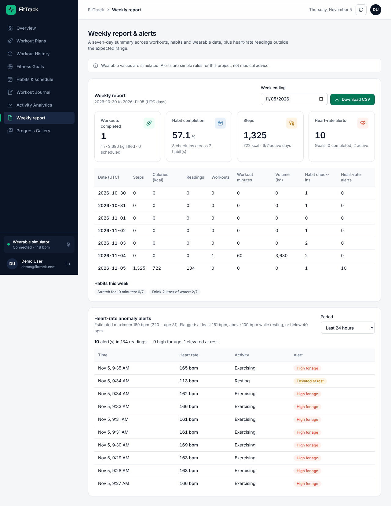

# Verification results — 26 October 2026, updated 5 November 2026

These are observed results, not a claim that every possible workflow is covered.

| Check | Result | Evidence |
|---|---|---|
| Backend unit tests | PASS, 5 tests | `npm test`: real calendar dates, safe positive record IDs, age calculation, age-based heart-rate limits and alert classification |
| Isolated MySQL/API integration | PASS, 40 checks | `npm run test:integration`; creates/drops random `fittrack_test_*` schema; report checks write and then delete their own Redis keys |
| Next.js production build | PASS | All 15 generated pages, including `/routine` and `/reports` |
| Frontend lint | Exit 0 with warnings | Fast Refresh export warnings, existing render-time Date and auth-effect warnings remain; not a warning-free result |
| Whitespace check | PASS | `git diff --check` |
| Additive local migration | PASS | `node database/migrate.js`; existing records retained |
| Installed constraints | PASS | Inspected information_schema: 17 CHECK constraints including original core and new name checks |
| Both database connections | PASS | `/api/health` returned `status: ok`, `mysql: connected`, `memurai: connected` |
| Live API smoke test | PASS, 17 checks | `npm run test:smoke`: journal/photo CRUD, telemetry, weekly report, heart-rate alerts, demo login and member admin denial; test-created records removed |
| SQL scripts | PASS | `database/queries.sql` (19 queries) runs without errors; `demo/03_crud_all_tables.sql` touches all 15 tables and ends with `leftover 0`, repeatable |
| WSL Redis | PASS | `redis-cli ping` returned PONG; Windows localhost connection succeeded after WSL startup |
| Browser tests (Playwright) | PASS, 55 checks | 34 general (every page, sign-in, sign-up, role access), 11 habits/schedule/coaching, 10 weekly report (7-day table, CSV download, alerts, earlier week, phone width) |
| Browser demo | PASS | Demo login, live dashboard/simulator, habit creation/check-in, dated workout schedule, coach subscription, weekly report and alerts visibly verified |

The 40 integration checks include unauthorized access, invalid dates, duplicate/idempotent check-ins, cross-user denial, duplicate schedules, subscription idempotence, SQL CHECK/FK rejection, transaction rollback, goal completion trigger, locked-session trigger, session volume function, authorized/unauthorized role procedure calls, and the weekly report and heart-rate alerts computed from known MySQL rows and Redis readings (including that one user cannot see another's report). No production or project tables are dropped by this suite.

## Screenshots

Captured from the running local application using the seeded Demo User, with generated wearable readings. The new demo habit, schedule and coaching enrolment remain available for rehearsal.

## Limits and final team checks

- The integration suite tests fresh schema and repeat application of the additive extension. It does not prove that every historic schema can be upgraded automatically. The current local core constraints were separately inspected.
- Screenshots show one browser width, not a comprehensive cross-browser/accessibility certification.
- Database role grants are table/column-level. The API enforces row ownership; direct database member credentials do not enforce per-user row isolation.
- `database/docs/er_diagram.png` / `.svg` show the complete 15-table ER diagram (same source as `ER_DIAGRAM.md` and `er_diagram.mmd`).
- Team attribution, section-wide title uniqueness and originality must be evidenced by the team.
- Heart-rate alerts are fixed-threshold rules on simulated data; they are not validated against real devices.
- Optional vector search is not implemented.
